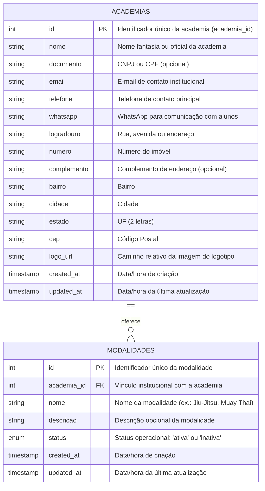

# Data Model: Cadastro e Perfil da Academia

**Feature**: `001-cadastro-academia` | **Date**: 2026-11-16

## 1. Diagrama Entidade-Relacionamento (ERD)

---

## 2. Dicionário de Dados

### Tabela: `academias`

Armazena as informações institucionais, de localização, contato e identidade visual da academia.

| Campo | Tipo | Nulo | Padrão | Descrição | Regras de Validação |
|-------|------|------|--------|-----------|---------------------|
| `id` | INT AUTO_INCREMENT | Não | - | Identificador único da academia | Chave primária |
| `nome` | VARCHAR(150) | Não | - | Nome da academia | Obrigatório, min 2, max 150 caracteres |
| `documento` | VARCHAR(20) | Sim | NULL | CNPJ ou CPF | Opcional, formato numérico sanitizado |
| `email` | VARCHAR(100) | Sim | NULL | E-mail de contato | Opcional, formato de e-mail válido |
| `telefone` | VARCHAR(20) | Sim | NULL | Telefone fixo ou móvel | Opcional |
| `whatsapp` | VARCHAR(20) | Sim | NULL | Número de WhatsApp | Pelo menos `telefone` ou `whatsapp` obrigatório |
| `logradouro` | VARCHAR(150) | Sim | NULL | Logradouro do endereço | Max 150 caracteres |
| `numero` | VARCHAR(20) | Sim | NULL | Número predial | Max 20 caracteres |
| `complemento` | VARCHAR(50) | Sim | NULL | Complemento do endereço | Max 50 caracteres |
| `bairro` | VARCHAR(100) | Sim | NULL | Bairro | Max 100 caracteres |
| `cidade` | VARCHAR(100) | Sim | NULL | Cidade | Max 100 caracteres |
| `estado` | CHAR(2) | Sim | NULL | Sigla da Unidade Federativa | 2 letras maiúsculas |
| `cep` | VARCHAR(10) | Sim | NULL | Código Postal | Formato sanitizado (ex.: 00000-000) |
| `logo_url` | VARCHAR(255) | Sim | NULL | URL relativa da imagem do logotipo | Extensões permitidas: .png, .jpg, .jpeg, .webp |
| `created_at` | TIMESTAMP | Não | CURRENT_TIMESTAMP | Data de cadastro | Gerado pelo banco |
| `updated_at` | TIMESTAMP | Não | CURRENT_TIMESTAMP ON UPDATE CURRENT_TIMESTAMP | Última alteração | Atualizado automaticamente |

---

### Tabela: `modalidades`

Armazena as modalidades esportivas ou variações de artes marciais oferecidas pela academia.

| Campo | Tipo | Nulo | Padrão | Descrição | Regras de Validação |
|-------|------|------|--------|-----------|---------------------|
| `id` | INT AUTO_INCREMENT | Não | - | Identificador único da modalidade | Chave primária |
| `academia_id` | INT | Não | - | Vínculo com a academia | Chave estrangeira para `academias.id` |
| `nome` | VARCHAR(100) | Não | - | Nome da modalidade | Obrigatório, min 2, max 100 caracteres |
| `descricao` | VARCHAR(255) | Sim | NULL | Detalhes adicionais da modalidade | Opcional, max 255 caracteres |
| `status` | ENUM('ativa', 'inativa') | Não | 'ativa' | Estado operacional da modalidade | Valores restritos a 'ativa' ou 'inativa' |
| `created_at` | TIMESTAMP | Não | CURRENT_TIMESTAMP | Data de cadastro | Gerado pelo banco |
| `updated_at` | TIMESTAMP | Não | CURRENT_TIMESTAMP ON UPDATE CURRENT_TIMESTAMP | Última alteração | Atualizado automaticamente |

---

## 3. Índices e Restrições de Integridade

- **Chave Primária `academias`**: `PRIMARY KEY (id)`
- **Chave Primária `modalidades`**: `PRIMARY KEY (id)`
- **Chave Estrangeira**: `CONSTRAINT fk_modalidades_academia FOREIGN KEY (academia_id) REFERENCES academias(id) ON DELETE RESTRICT`
- **Índice de Unicidade**: `UNIQUE KEY uk_academia_modalidade (academia_id, nome)` — impede cadastrar duas modalidades com o mesmo nome na mesma academia.
- **Índice de Consulta**: `INDEX idx_modalidades_status (academia_id, status)` — otimiza listagem de modalidades ativas.
