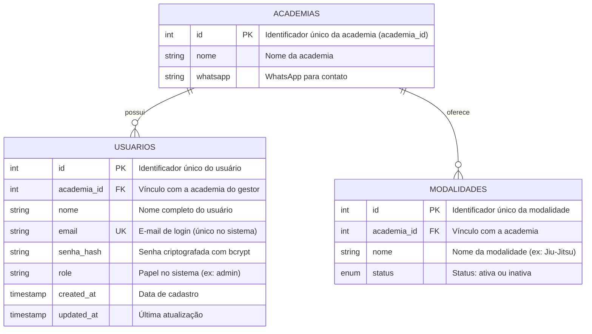

# Data Model: Autenticação, Usuários e Onboarding

**Feature**: `002-auth-onboarding` | **Date**: 2026-11-16

## 1. Diagrama Entidade-Relacionamento (ERD Atualizado)

---

## 2. Dicionário de Dados

### Tabela: `usuarios`

Armazena as credenciais de acesso e os dados pessoais dos gestores e operadores da academia.

| Campo | Tipo | Nulo | Padrão | Descrição | Regras de Validação |
|-------|------|------|--------|-----------|---------------------|
| `id` | INT AUTO_INCREMENT | Não | - | Identificador único do usuário | Chave primária |
| `academia_id` | INT | Não | - | Vínculo com a academia | Chave estrangeira para `academias.id` |
| `nome` | VARCHAR(150) | Não | - | Nome completo do usuário | Obrigatório, min 2, max 150 caracteres |
| `email` | VARCHAR(150) | Não | - | E-mail para autenticação | Obrigatório, formato de e-mail válido, único no sistema |
| `senha_hash` | VARCHAR(255) | Não | - | Hash bcrypt da senha | Obrigatório, gerado a partir de senha de min 6 caracteres |
| `role` | VARCHAR(50) | Não | 'admin' | Papel operacional | Valores: 'admin', 'professor' |
| `created_at` | TIMESTAMP | Não | CURRENT_TIMESTAMP | Data de criação | Gerado pelo banco |
| `updated_at` | TIMESTAMP | Não | CURRENT_TIMESTAMP ON UPDATE CURRENT_TIMESTAMP | Última alteração | Atualizado automaticamente |

---

## 3. Índices e Restrições de Integridade

- **Chave Primária**: `PRIMARY KEY (id)`
- **Chave Estrangeira**: `CONSTRAINT fk_usuarios_academia FOREIGN KEY (academia_id) REFERENCES academias(id) ON DELETE CASCADE`
- **Índice de Unicidade**: `UNIQUE KEY uk_usuarios_email (email)` — impede cadastro duplicado de e-mail.
- **Índice de Vínculo**: `INDEX idx_usuarios_academia (academia_id)` — otimiza consultas de operadores por academia.
