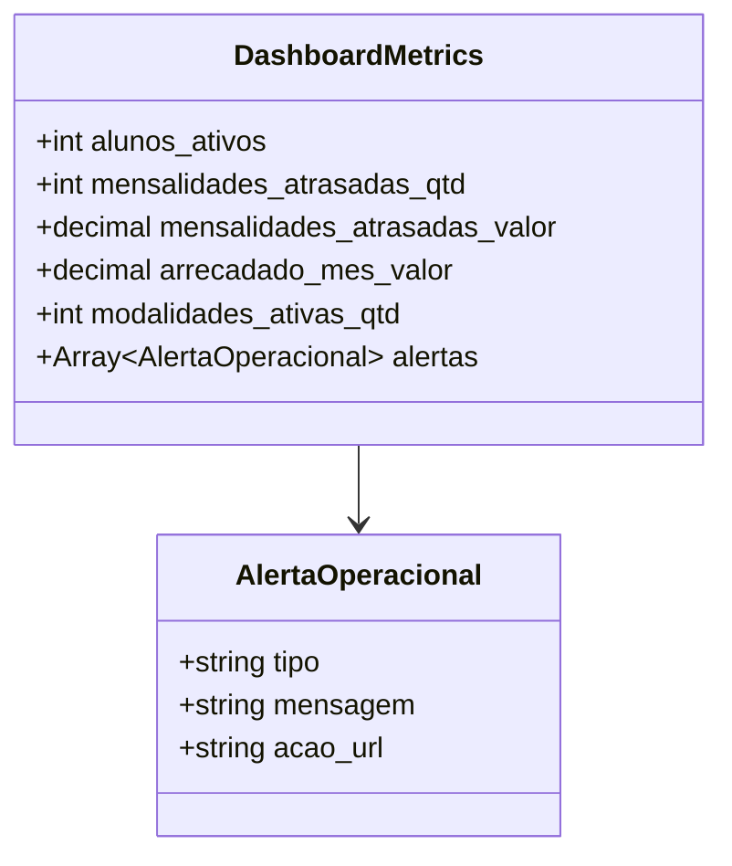

# Data Model: Dashboard Operacional e Métricas

**Feature**: `003-dashboard-overview` | **Date**: 2026-11-16

## 1. Esquema de Agregação de Dados (`DashboardMetrics`)

O Dashboard consolida dados de entidades existentes (`academias`, `modalidades`) e das futuras entidades financeiras e cadastrais (`alunos`, `mensalidades`, `pagamentos`), retornando um payload estruturado e determinístico.

---

## 2. Dicionário do Payload de Resposta (`GET /api/dashboard/metrics`)

| Propriedade | Tipo | Descrição | Exemplo |
|-------------|------|-----------|---------|
| `alunos_ativos` | Integer | Número total de alunos com status ativo | `42` |
| `mensalidades_atrasadas_qtd` | Integer | Quantidade de mensalidades vencidas não pagas | `3` |
| `mensalidades_atrasadas_valor` | Number (2 dec) | Valor total em aberto de mensalidades vencidas | `570.00` |
| `arrecadado_mes_valor` | Number (2 dec) | Total de pagamentos confirmados no mês atual | `4850.00` |
| `modalidades_ativas_qtd` | Integer | Total de modalidades ativas oferecidas | `2` |
| `alertas` | Array~Object~ | Alertas prioritários para o professor | `[{ "tipo": "vencimento", "mensagem": "3 mensalidades vencem hoje" }]` |

---

## 3. Isolamento e Validação por Tenant

- Todas as consultas executam com a cláusula obrigatória `WHERE academia_id = ?` obtida a partir do token JWT do usuário autenticado.
- Em bancos recém-inicializados sem tabelas de alunos ou mensalidades criadas, os contadores retornam `0` e os valores monetários retornam `0.00` de forma segura.
