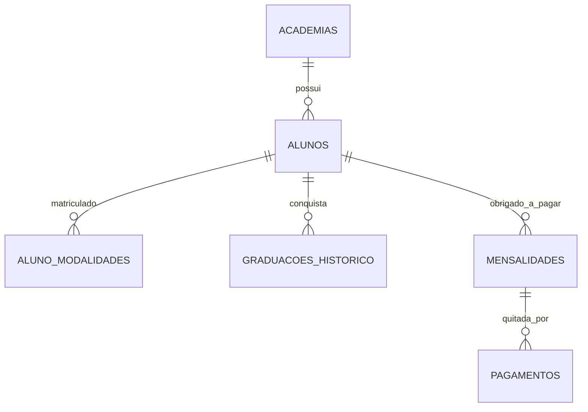
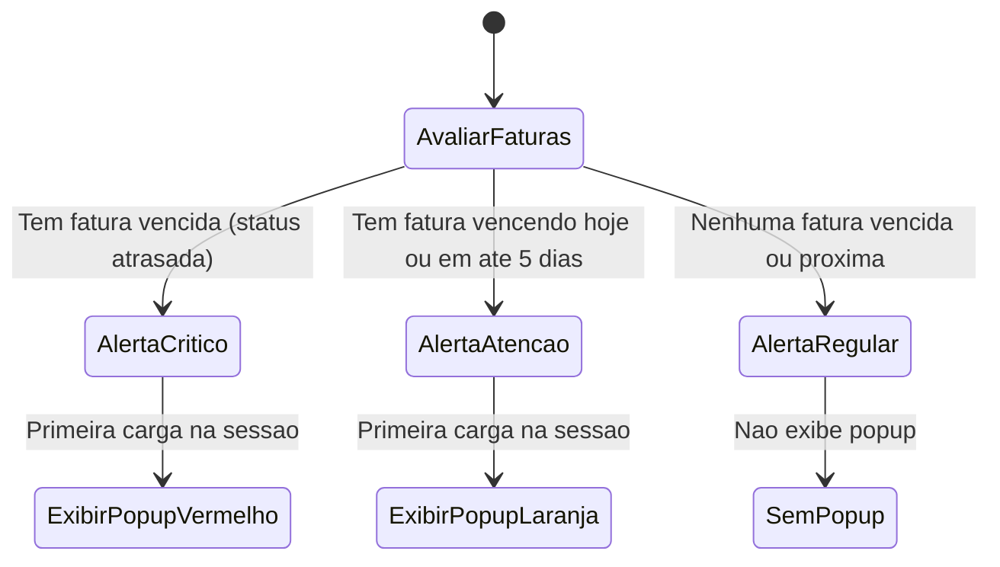

# Data Model: Área e Hub do Aluno

**Feature**: `006-area-do-aluno`  
**Date**: 2026-11-17

---

## 1. Modificações de Esquema (Schema Changes)

### Tabela `alunos` (Alteração via Migration `007_add_aluno_auth.sql`)

Novas colunas para credenciais de acesso do aluno:

```sql
ALTER TABLE alunos
  ADD COLUMN email VARCHAR(150) NULL AFTER telefone,
  ADD COLUMN senha_hash VARCHAR(255) NULL AFTER email,
  ADD COLUMN primeiro_acesso BOOLEAN DEFAULT TRUE NOT NULL AFTER senha_hash,
  ADD COLUMN ultimo_login TIMESTAMP NULL AFTER primeiro_acesso,
  ADD UNIQUE KEY uk_alunos_academia_email (academia_id, email),
  ADD INDEX idx_alunos_login_telefone (academia_id, telefone);
```

| Campo | Tipo | Nulo | Descrição |
|-------|------|------|-----------|
| `email` | VARCHAR(150) | SIM | E-mail opcional para contato e login do aluno |
| `senha_hash` | VARCHAR(255) | SIM | Hash bcrypt da senha de acesso ao portal |
| `primeiro_acesso` | BOOLEAN | NÃO (Default TRUE) | Indica se o aluno ainda precisa definir sua própria senha |
| `ultimo_login` | TIMESTAMP | SIM | Data e hora do último acesso ao portal |

---

## 2. Entidades de Domínio e Relacionamentos



---

## 3. Entidades Lógicas e Payloads de Resposta (Hub do Aluno)

### `AlunoHubPayload` (Objeto canônico retornado em `GET /api/aluno/hub`)

```json
{
  "aluno": {
    "id": 1,
    "nome": "Lucas Silveira",
    "telefone": "11988887777",
    "email": "lucas@email.com",
    "data_matricula": "2026-01-10",
    "primeiro_acesso": false
  },
  "academia": {
    "id": 1,
    "nome": "Tatamy Fight Club",
    "logo_url": "/uploads/logos/tatamy.png",
    "whatsapp": "11999998888",
    "chave_pix": "11999998888"
  },
  "graduacao_atual": {
    "modalidade_id": 2,
    "modalidade_nome": "Jiu-Jitsu",
    "faixa": "Azul",
    "graus": 2,
    "data_graduacao": "2026-06-15"
  },
  "alerta": {
    "tipo": "atrasada", 
    "titulo": "Mensalidade em Atraso",
    "mensagem": "Você possui 1 fatura vencida há 5 dias no valor de R$ 150,00.",
    "fatura_id": 12,
    "valor": 150.00,
    "data_vencimento": "2026-11-12",
    "dias_atraso": 5,
    "dias_para_vencer": 0,
    "deve_exibir_popup": true
  },
  "resumo_financeiro": {
    "faturas_abertas_count": 1,
    "total_pendente": 150.00,
    "proxima_fatura": {
      "id": 12,
      "competencia": "11/2026",
      "valor": 150.00,
      "data_vencimento": "2026-11-12",
      "status": "atrasada"
    }
  },
  "faturas_recentes": [
    {
      "id": 12,
      "competencia": "11/2026",
      "valor": 150.00,
      "valor_pago": 0.00,
      "data_vencimento": "2026-11-12",
      "status": "atrasada"
    }
  ],
  "historico_graduacoes": [
    {
      "id": 5,
      "modalidade_nome": "Jiu-Jitsu",
      "faixa": "Azul",
      "graus": 2,
      "data_graduacao": "2026-06-15",
      "observacao": "Graduado pelo Mestre Carlos"
    },
    {
      "id": 2,
      "modalidade_nome": "Jiu-Jitsu",
      "faixa": "Branca",
      "graus": 4,
      "data_graduacao": "2026-01-10",
      "observacao": "Matrícula inicial"
    }
  ]
}
```

---

## 4. Máquina de Estados do Alerta Financeiro do Aluno


