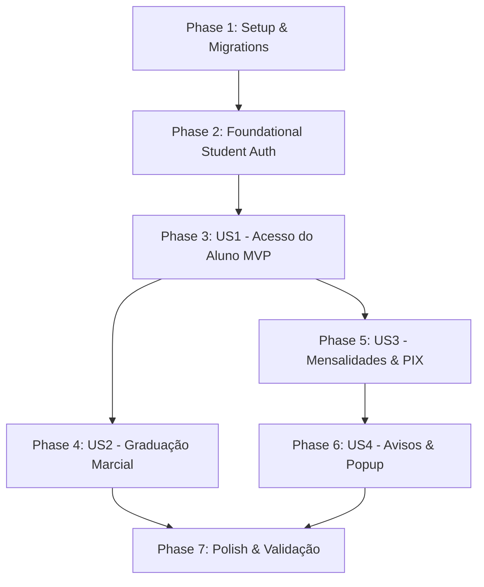

# Tasks: Área e Hub do Aluno

**Input**: Design documents from `specs/006-area-do-aluno/`  
**Prerequisites**: `plan.md`, `spec.md`, `research.md`, `data-model.md`, `contracts/`, `quickstart.md`

## Format: `[ID] [P?] [Story] Description`

- **[P]**: Tarefas que podem ser executadas em paralelo (arquivos distintos, sem dependência mútua)
- **[Story]**: Histórias de usuário da especificação (`US1`, `US2`, `US3`, `US4`)
- Inclui caminhos exatos dos arquivos

---

## Phase 1: Setup (Infraestrutura e Migrações)

**Purpose**: Estrutura inicial e persistência de credenciais no banco de dados

- [x] T001 Criar migration `007_add_aluno_auth.sql` em `backend/src/database/migrations/007_add_aluno_auth.sql` adicionando colunas `email`, `senha_hash`, `primeiro_acesso` e `ultimo_login` na tabela `alunos`
- [x] T002 Executar migrations no banco com `npm run migrate` em `backend/`
- [x] T003 [P] Criar serviço cliente da API do portal `studentPortalService.js` em `frontend/src/services/studentPortalService.js`

---

## Phase 2: Foundational (Infraestrutura de Autenticação do Aluno)

**Purpose**: Camada base de segurança e sessão JWT que bloqueia o desenvolvimento das histórias de usuário

**⚠️ CRITICAL**: Nenhuma história de usuário do portal pode ser acessada sem esta base concluída

- [x] T004 Implementar middleware de autenticação de alunos `authenticateStudentJWT` em `backend/src/middlewares/studentAuth.js` validando `role === 'aluno'` e isolando `aluno_id` e `academia_id`
- [x] T005 [P] Implementar repositório base `StudentPortalRepository` com busca por telefone/email em `backend/src/modules/studentPortal/studentPortal.repository.js`
- [x] T006 [P] Criar contexto de autenticação de alunos `StudentAuthContext.jsx` e hook `useStudentAuth.js` em `frontend/src/context/StudentAuthContext.jsx` e `frontend/src/hooks/useStudentAuth.js`
- [x] T007 [P] Implementar guarda de rota autenticada `<StudentProtectedRoute />` em `frontend/src/components/studentPortal/StudentProtectedRoute.jsx`

**Checkpoint**: Fundação pronta - autenticação e isolamento de alunos disponíveis para as histórias.

---

## Phase 3: User Story 1 - Acesso e Autenticação no Portal do Aluno (Priority: P1) 🎯 MVP

**Goal**: Permitir que o gestor defina credenciais e o aluno realize login seguro no portal via smartphone/desktop

**Independent Test**: Definir senha para um aluno, acessar `/aluno/login`, efetuar login com telefone/senha e validar que a sessão é iniciada com o token do aluno.

### Implementação da User Story 1

- [x] T008 [US1] Implementar métodos `login` e `getMe` em `backend/src/modules/studentPortal/studentPortal.service.js` utilizando `bcryptjs` e gerando JWT com claim `role: 'aluno'`
- [x] T009 [US1] Implementar controller `StudentPortalController.login` e `StudentPortalController.getMe` em `backend/src/modules/studentPortal/studentPortal.controller.js`
- [x] T010 [US1] Configurar rotas `/login` e `/me` em `backend/src/modules/studentPortal/studentPortal.routes.js` e registrar `/api/aluno` em `backend/src/routes.js`
- [x] T011 [US1] Implementar rota administrativa `PATCH /api/alunos/:id/credenciais` para o gestor definir/resetar a senha do aluno em `backend/src/modules/students/students.controller.js` e `students.repository.js`
- [x] T012 [US1] Adicionar botão e modal "Acesso ao Portal" na tela de detalhes do aluno em `frontend/src/pages/Students/StudentDetailPage.jsx` para o gestor definir a senha inicial
- [x] T013 [US1] Criar tela de login do aluno `StudentLoginPage.jsx` e estilos `StudentLoginPage.module.css` em `frontend/src/pages/StudentLogin/` com design mobile-first
- [x] T014 [US1] Configurar rotas `/aluno/login` e redirecionamentos no roteador principal `frontend/src/App.jsx`

**Checkpoint**: User Story 1 funcional! Alunos agora conseguem se autenticar no portal de autoatendimento.

---

## Phase 4: User Story 2 - Hub do Aluno: Graduação Atual e Jornada Marcial (Priority: P1)

**Goal**: Exibir a graduação marcial atual com a fidelidade das faixas oficiais (`BeltBadge`), contagem de graus e histórico cronológico

**Independent Test**: Logar com um aluno que possui graduação e verificar que o Hub exibe a faixa exata, graus e linha do tempo de promoções.

### Implementação da User Story 2

- [x] T015 [US2] Implementar consulta de graduação atual e histórico em `StudentPortalRepository.getGraduations` em `backend/src/modules/studentPortal/studentPortal.repository.js`
- [x] T016 [US2] Implementar método `getHubOverview` em `backend/src/modules/studentPortal/studentPortal.service.js` agregando dados do aluno, academia e graduação
- [x] T017 [US2] Criar endpoint `GET /api/aluno/hub` em `backend/src/modules/studentPortal/studentPortal.controller.js` e `studentPortal.routes.js`
- [x] T018 [US2] Criar componente visual `StudentBeltCard.jsx` e estilos `StudentBeltCard.module.css` em `frontend/src/components/studentPortal/StudentBeltCard/` renderizando faixa e graus
- [x] T019 [US2] Criar página `StudentHubPage.jsx` e estilos `StudentHubPage.module.css` em `frontend/src/pages/StudentHub/` renderizando o cabeçalho do aluno e o card de graduação

**Checkpoint**: User Story 2 funcional! O aluno acompanha sua evolução técnica e graduações no Hub.

---

## Phase 5: User Story 3 - Consulta de Mensalidades e Pagamento Facilitado (Priority: P1)

**Goal**: Exibir mensalidades do aluno (pendentes, pagas e atrasadas) com botão de 1 toque para copiar a chave PIX da academia

**Independent Test**: Cadastrar uma mensalidade para o aluno, acessar o Hub, visualizar valor e vencimento, e clicar em "Copiar Chave PIX" validando o clipboard.

### Implementação da User Story 3

- [x] T020 [US3] Implementar busca de mensalidades e chave PIX da academia em `StudentPortalRepository.getInvoices` em `backend/src/modules/studentPortal/studentPortal.repository.js`
- [x] T021 [US3] Criar endpoint `GET /api/aluno/mensalidades` em `backend/src/modules/studentPortal/studentPortal.controller.js` e `studentPortal.routes.js`
- [x] T022 [US3] Criar componente `StudentInvoiceCard.jsx` e estilos `StudentInvoiceCard.module.css` em `frontend/src/components/studentPortal/StudentInvoiceCard/` com botão de cópia de PIX
- [x] T023 [US3] Integrar lista de faturas e histórico de pagamentos na página `StudentHubPage.jsx` em `frontend/src/pages/StudentHub/`

**Checkpoint**: User Story 3 funcional! O aluno consulta faturas e copia a chave PIX sem atrito.

---

## Phase 6: User Story 4 - Avisos Dinâmicos no Hub e Notificação Popup (Priority: P2)

**Goal**: Notificar o aluno imediatamente com banner no topo do Hub e popup modal ao abrir o portal quando houver fatura atrasada ou próxima do vencimento (<= 5 dias)

**Independent Test**: Simular aluno com fatura vencendo em 3 dias e verificar se o popup modal abre na primeira visita e o banner de aviso é exibido no topo.

### Implementação da User Story 4

- [x] T024 [US4] Implementar lógica de apuração de alerta financeiro `calculateFinancialAlert` em `backend/src/modules/studentPortal/studentPortal.service.js` (detecta faturas atrasadas ou vencendo em <= 5 dias)
- [x] T025 [US4] Integrar payload do alerta no objeto retornado por `GET /api/aluno/hub` em `backend/src/modules/studentPortal/studentPortal.service.js`
- [x] T026 [US4] Criar componente `StudentAlertBanner.jsx` e estilos `StudentAlertBanner.module.css` em `frontend/src/components/studentPortal/StudentAlertBanner/` com estilos para Crítico (Vermelho), Atenção (Laranja) e Regular (Verde)
- [x] T027 [US4] Criar componente `StudentNotificationPopup.jsx` e estilos `StudentNotificationPopup.module.css` em `frontend/src/components/studentPortal/StudentNotificationPopup/` com dismiss controlado via `sessionStorage`
- [x] T028 [US4] Integrar o banner de alerta e o popup de notificação no topo da página `StudentHubPage.jsx` em `frontend/src/pages/StudentHub/`

**Checkpoint**: User Story 4 funcional! Alunos são notificados instantaneamente ao acessar o Hub.

---

## Phase 7: Polish & Validação Ponta a Ponta

**Purpose**: Verificação completa, testes automatizados e validação de build

- [x] T029 [P] Criar e executar script de teste de integração automatizado `test_student_portal.js` em `backend/scripts/test_student_portal.js` validando credenciais, login, hub, PIX e popups
- [x] T030 [P] Executar build de produção do frontend (`npm run build`) validando bundling Vite e PWA
- [x] T031 Executar homologação final dos cenários descritos em `specs/006-area-do-aluno/quickstart.md`

---

## Dependencies & Execution Order

### Oportunidades de Execução Paralela

- **Na Fase 1**: T001 e T003 podem rodar em paralelo.
- **Na Fase 2**: T005, T006 e T007 podem ser implementadas em paralelo.
- **Após a US1 (MVP)**: US2 (Graduação) e US3 (Mensalidades) podem ser desenvolvidas em paralelo por tocarem em componentes visuais independentes.
- **Na Fase 7**: T029 (teste backend) e T030 (build frontend) rodam em paralelo.

---

## Implementation Strategy (MVP First)

1. **Sprint 1 (MVP Foundation + US1)**: Executar Fases 1, 2 e 3. Permite ao gestor criar senhas e aos alunos acessarem o portal.
2. **Sprint 2 (Graduação & Financeiro)**: Executar Fases 4 e 5. Disponibiliza a faixa marcial do aluno e a visualização/cópia de PIX de faturas.
3. **Sprint 3 (Inteligência de Cobrança)**: Executar Fase 6. Adiciona o banner dinâmico e o popup automático de aviso de vencimento/atraso.
4. **Sprint 4 (Homologação)**: Executar Fase 7.
